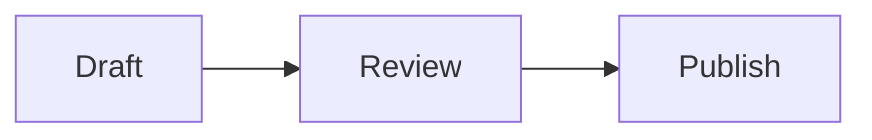

# Markdown Viewer

A Windows desktop app for browsing, previewing, and editing Markdown files in a selected folder. Once installed, it also appears in File Explorer's **Open with** menu for `.md` and `.markdown` files.

## Overview

Markdown Viewer is a WinUI app built with .NET. It lets you choose a folder, lists Markdown files from that folder and its subfolders, and shows each file in two tabs:

- `Preview` renders a readable Markdown view.
- `Source` shows the editable source text.

The preview supports common Markdown shapes such as headings, paragraphs, lists, block quotes, horizontal rules, fenced code blocks, project folder trees, tables, inline code markers, emphasis markers, links, and Mermaid diagrams.

## App Workflow

1. Choose a folder. The selected folder path stays visible in the header.
2. Files open in **Folder tree** view by default. Use the sidebar's **List view / Folder tree** selector to change how files are shown. List rows show filenames and relative paths. Both views contain `.md` and `.markdown` files only.
3. Read it in the `Preview` tab. Preview text can be selected and copied with the
   standard Windows mouse and keyboard shortcuts. Press `Ctrl+A`, then `Ctrl+C`,
   to copy the complete rendered preview, including tables.
4. Click **Edit source** beside the document header to change the source in the `Source` tab.
5. Save writes the file directly and keeps the editor open. **Discard changes** asks for confirmation before reloading the saved file. Use the refresh button to rescan the folder when files change outside the app.
   **Cancel** leaves editing immediately when there are no changes. With unsaved changes, choose **Save**, **Discard changes**, or **Cancel** to keep editing.
6. Use the theme button to switch between light and dark mode.

Mermaid diagrams use a fenced block labeled `mermaid`:

````markdown

````

You can also right-click an `.md` or `.markdown` file in File Explorer and choose **Open with > Markdown Viewer**. The app opens that file and lists the other Markdown files in its containing folder.

The app blocks folder changes and file switches while there are unsaved edits, so changes are not lost by accident.
The compact document header groups the filename, relative path, edit status, and actions. Preview uses a centered reading column up to 860 pixels wide, with tighter paragraph spacing. Preview and source fonts support both Latin and Myanmar text.
The sidebar contains folder actions, search, and file navigation. On narrow windows it opens over the document using the sidebar button. The welcome screen guides you to open a folder or choose a document.
The app starts maximized and uses the main Markdown Viewer logo for the welcome screen, title bar, executable, and Windows package visuals.
Use the information button beside the theme button to open **About Markdown Viewer**, with the running app version, an overview of features, author credit, and a link to the GitHub repository. **Check for updates** opens the latest GitHub release in your browser.
Hold **Ctrl** and scroll the mouse wheel over the preview to zoom in or out (75%–250%). Normal scrolling still moves through the document; the source editor and toolbar stay at their usual size.

## Development Workflow

Requirements:

- Windows 10 version 1809 or later.
- .NET 10 SDK.

Restore and build:

```powershell
dotnet restore MarkdownViewerApp.slnx
dotnet build MarkdownViewerApp.slnx -c Debug
```

Run:

```powershell
dotnet run --project MarkdownViewerApp\MarkdownViewerApp.csproj
```

Use conventional commit messages for repository changes:

```powershell
git add README.md
git commit -m "docs: add project README"
git push
```

## Project Structure

```text
MarkdownViewerApp.slnx
MarkdownViewerApp/
  App.xaml
  MainWindow.xaml
  MainPage.xaml
  MainPage.xaml.cs
  MarkdownViewerApp.csproj
  Assets/
```

- `MainWindow` sets up the app window and navigates to `MainPage`.
- `MainPage` owns folder picking, file loading, editing, saving, and Markdown preview rendering.
- `Assets` contains app icons and package images.
